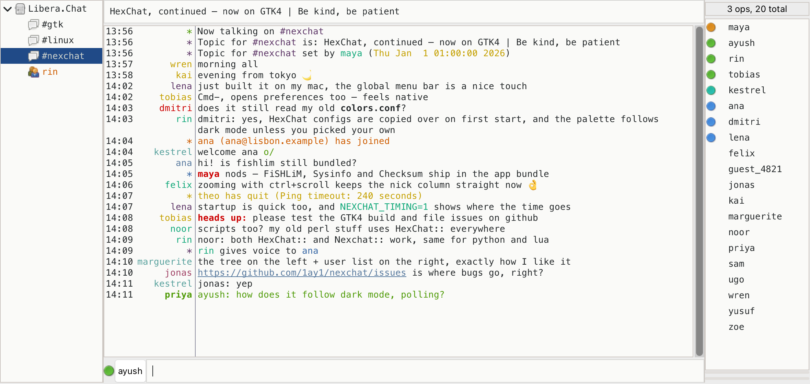

# nexchat

**HexChat, continued.**

<picture>
  <source media="(prefers-color-scheme: dark)" srcset="docs/screenshots/nexchat-dark.png">
  
</picture>

nexchat is an IRC client for Linux, BSD, Windows and macOS. It's a continuation of [HexChat](https://github.com/hexchat/hexchat), which was archived in 2024.

That's the whole idea: the same HexChat you know, with the same layout, menus, dialogs and keybindings, moved onto a current toolkit (GTK4) and kept working. Nothing is redesigned for its own sake. See [ROADMAP.md](ROADMAP.md) for the plan and [docs/ux-reference](docs/ux-reference) for the screenshots every change is checked against.

Coming from HexChat:
- On first start, nexchat copies `~/.config/hexchat` (or `%APPDATA%\HexChat`) to `~/.config/nexchat`. Your HexChat folder is left as it is.
- Plugins and scripts keep working. The C API is unchanged (`hexchat-plugin.h`, or the new `nexchat-plugin.h`). Python can use `import hexchat` or `import nexchat`, Lua has both `hexchat` and `nexchat`, and Perl has `HexChat::` and `Nexchat::`.
- Themes (`.hct`) and `colors.conf` work the same.

The HexChat documentation still applies: [docs](https://hexchat.readthedocs.org/en/latest/index.html), [Python API](https://hexchat.readthedocs.org/en/latest/script_python.html), [Perl API](https://hexchat.readthedocs.org/en/latest/script_perl.html).

## Building

```sh
meson setup build
ninja -C build
meson test -C build   # needs -Dtext-frontend=true for the smoke tests
```

On macOS (Homebrew: `brew install meson gtk4 openssl@3`), `ninja -C build app` also makes a self-contained `build/nexchat.app` you can drag to Applications.

The screenshot above is regenerated with `tests/ux/readme-shot.sh build/src/fe-gtk/nexchat docs/screenshots`, against a fake IRC server; nobody's real chat is in it.

---

<sub>
X-Chat ("xchat") Copyright (c) 1998-2010 By Peter Zelezny.  
HexChat ("hexchat") Copyright (c) 2009-2014 By Berke Viktor.
</sub>

<sub>
This program is released under the GPL v2 with the additional exemption
that compiling, linking, and/or using OpenSSL is allowed. You may
provide binary packages linked to the OpenSSL libraries, provided that
all other requirements of the GPL are met.
See file COPYING for details.
</sub>
